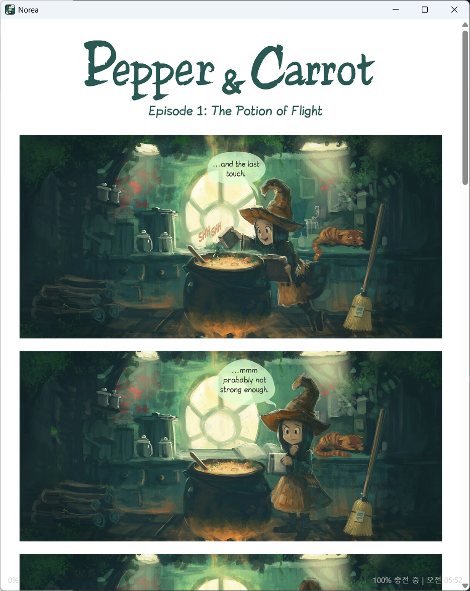
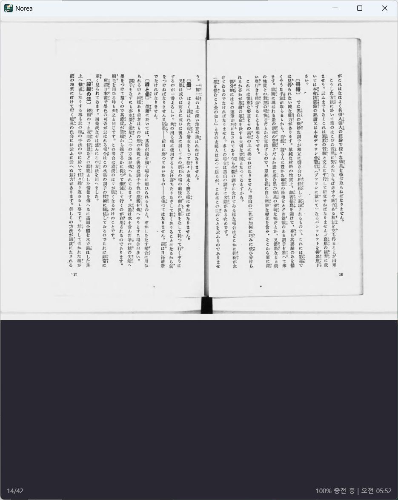

# Norea

Norea is a local-first reader for light novels, webtoons, and manga on Windows
and Android.
It keeps your reading sources, library, downloads, and progress in one app.

Norea is inspired by [lnreader/lnreader](https://github.com/lnreader/lnreader),
but it is a separate app with its own data, backup, and source system.

## Screenshots

<p align="center">
  
</p>

<p align="center">
  
  
  
</p>

### Webtoon and Manga Reading

Norea supports image-based chapters as well as text. Scroll through long-strip
webtoons or read manga and comics page by page.

<p align="center">
  
  
</p>

## What You Can Do

- Browse and search installed reading sources.
- Add novels to your library and organize them with categories.
- Import local plain text, HTML, Markdown, EPUB, and PDF files.
- Open TXT, Markdown, EPUB, and PDF files with installed Windows or Android builds,
  add them as chapters of the shared `local` work, and open the selected file in the reader.
- Cache rendered chapter media for offline reading.
- Route source-plugin requests through an app-local OpenVPN tunnel on Windows
  and Android, using an imported `.ovpn` profile or the built-in VPN Gate server
  finder.
- Keep local files in one work on Windows and Android, reorder its chapters, and
  manage local metadata with locally uploaded cover images.
- Read text, webtoon, and manga chapters in paged or scrolling mode.
- Change themes, font size, text color, tap zones, and keyboard navigation.
- Track reading progress, history, unread chapters, and downloaded chapters.
- Download chapters for later reading.
- Share complete chapters through an optional [content server](docs/content-sync.md).
  Browse its works under Browse -> Content server, add them to your library, and
  download chapters without waiting for a full sync. Devices register
  automatically; reading state stays on each device.
- Export and import local backups for your library, progress, categories,
  source settings, and chapter download status.

## Current State

Norea is usable for testing, but it is not a polished app-store release yet.

Current limits:

- macOS and iOS are not planned right now.
- Linux builds are no longer produced or supported.
- Some protected sources may ask you to open the in-app site browser once before
  search or downloads work.
- Android background downloads still need more device testing.
- There is no automatic updater yet. Use Settings -> About to check and
  download newer builds manually.

## Download

For regular installs, use the
[latest GitHub release](https://github.com/tinywind/norea/releases/latest).
Release assets are the stable public downloads.

For a newer tester build from the current `main` branch, use the
[dev-0.2 GitHub prerelease](https://github.com/tinywind/norea/releases/dev-0.2).
Successful platform workflows refresh its installers, packages, APKs, update
metadata, and checksums.

Workflow artifacts remain available as a fallback while the prerelease is being
refreshed:

1. Open the latest successful workflow run for your platform:
   [Windows](https://github.com/tinywind/norea/actions/workflows/windows.yml?query=branch%3Amain+is%3Asuccess) or
   [Android](https://github.com/tinywind/norea/actions/workflows/android.yml?query=branch%3Amain+is%3Asuccess).
2. Open the run and scroll to Artifacts.
3. Download the matching artifact:

| Platform | What to download |
| --- | --- |
| Windows x64 | `norea-windows-x64-nsis` or `norea-windows-x64-msi` |
| Windows ARM64 | `norea-windows-arm64-nsis` or `norea-windows-arm64-msi` |
| Android phone or tablet | `norea-arm64.apk` |
| Android emulator or WSA | `norea-x86_64.apk` |

Workflow artifacts are kept for 30 days. If an artifact is expired, use a newer
successful run, the dev-0.2 prerelease, or the latest stable release.

## First Run

1. Install and open Norea.
2. Add a reading source list from Browse -> Sources.
3. Install one or more sources.
4. Search a source, open a novel, and add it to your library.
5. Open a chapter to read. Download chapters you want available later.

## Add Reading Sources

Reading sources are installed separately from the app. The sample source list is
maintained at [tinywind/norea-plugins](https://github.com/tinywind/norea-plugins)
and focuses on public-domain, open-license, official-API, and user-owned
self-hosted examples.

To add the sample source list:

1. Open Browse -> Sources.
2. Choose Set repository.
3. Paste this URL:

   ```text
   https://raw.githubusercontent.com/tinywind/norea-plugins/dist/v0.2/.dist/plugins.json
   ```

4. Save it.
5. Install sources from Available source plugins.

Only install and use sources you are allowed to access in your country and under
the source site's terms.

## Optional Content Server

[Norea Content Server](https://github.com/tinywind/norea-content-server) stores
complete chapter files so you can upload content from one device and download
it on another. An archived copy remains available when the original source site
is offline or removes a work.

The server is an optional shadow backup. Library navigation, saved work details,
and locally downloaded reading must remain usable immediately, even while the
server is slow or unavailable. Automatic server lookups, transfers, and refreshes
run in the background and must never add blocking loaders, error banners, or
other interruptions to normal use. Actions you explicitly request, such as a
server download or manual sync, still report failures that prevent completion.

### Start with Docker

The public [Docker image](https://hub.docker.com/r/tinywind0/norea-content-server)
supports `linux/amd64` and `linux/arm64`, including Linux containers on Docker
Desktop. To start a server with persistent storage:

```sh
docker volume create norea-content-data
docker run -d --name norea-content-server --restart unless-stopped -p 0.0.0.0:8080:8787 -v norea-content-data:/data tinywind0/norea-content-server:0.1.0
```

Open `http://localhost:8080/admin/` on the host. The administration console and
content API share port 8080; there is no separate console port. First startup
creates the console password in the data volume. Read it privately with:

```sh
docker exec norea-content-server cat /data/admin-password.hash
```

Keep the data volume across container replacements: it contains the catalog,
chapter files, and console password. The command publishes port 8080 on all
host interfaces. Devices on your network can use `http://<server-LAN-IP>:8080`
when the host firewall permits access. New devices register automatically and
downloads are anonymous by default, so anyone who can reach the server can
register a device. Use a trusted network or configure restricted remote access
as described in the [server documentation](https://github.com/tinywind/norea-content-server#run-locally).

### Connect Norea

1. Open Settings -> Data -> Content server.
2. Save the server URL and a device name. On a phone or tablet, use the server's
   LAN address; `localhost` refers to that phone or tablet.
3. Choose Sync now to register the device and upload complete local chapters.
4. Choose Download to this device for content in the server catalog.

No account or password is needed in the app. Each device uses its own key;
reading positions, read flags, bookmarks, and library membership stay local.
Choose Manual only, Periodically, or When changes occur. Automatic sync runs
while the app is visible, and later syncs use recorded content changes.

Complete chapters upload as multipart requests containing the original
`content.html` or `content.pdf`, plus `manifest.json` and `media.zip` when present.
The app sends these files byte for byte, without creating an extra ZIP, rewriting
HTML or media references, or recompressing media. The server publishes a revision
only after every listed file arrives with its declared size. Transfers check
file names, sizes, and completion without computing or comparing chapter-file
SHA-256 hashes. Downloads support only the current original-file format.
Deleting a local download
leaves the server copy intact. The server keeps one complete copy per chapter.
The app checks for that copy before creating a snapshot or uploading files.
To replace a server copy, select chapters in the work page, choose **Delete from
server**, then use **Rescan local files and sync**. Server deletion preserves
local files and reading state.

Work metadata and covers sync independently of chapter downloads. Each work's
`novel.json` stores its details beside its cover, without a chapter list or source
cover URL. The plugin ID, source path, and work name are the only required fields;
a local rescan rebuilds the metadata cache and discovers cover and chapter files.
Downloaded chapters are discovered from their existing folders and files.
These files are authoritative; the app keeps metadata in SQLite for browsing and
search, including works with no downloaded chapters. Opening saved works does not
require fetching their metadata from the source site again.

The web console manages devices, server copies, scan jobs, and multiple
plugin repository indexes. The server uses its configured data directory for
content storage and scanning; the console does not select additional folders.
Scanning requires valid `novel.json` work metadata and discovers chapters from
their folders and files without contacting source sites or requiring installed
plugins. Unsupported or incomplete files are skipped; original files are
preserved. Works and their covers remain
available even when none of their chapters can be imported. The console offers
cover grids, a list view, and full metadata inspection.

See [content-server integration](docs/content-sync.md) for sync behavior and
current limits, and the [server's administration guide](https://github.com/tinywind/norea-content-server#administration-console)
for folder import and server configuration.

## Backup

Use Settings -> Backup to export or import your local library data. Backups
include your library, reading progress, categories, source settings, installed
sources, and chapter download status. Downloaded chapter bodies and cached
chapter media are not packed into the backup; they stay in the chapter storage
folder, and Norea re-checks that folder after a restore so download flags match
the files that are actually present. Only the current manifest format 2 is supported.

## Version Compatibility

During early development, Norea supports only the current database, settings,
metadata, backup, and content-server formats. There are no upgrade migrations,
old-format readers, or settings translations. A schema version or checksum
mismatch recreates the app database; downloaded files remain on disk and can be
rescanned when they follow the current file format. Use current app and server
builds together. Any future compatibility policy will be decided separately.

Maintainer details live in
[docs/release-compatibility.md](./docs/release-compatibility.md).

## For Developers

Developer setup, local plugin testing, release artifact details, and
contribution rules live in [docs/development.md](./docs/development.md).

Optional content-server setup and current integration limits are documented in
[docs/content-sync.md](./docs/content-sync.md).

## License

MIT. Upstream assets and translation seeds remain MIT-compatible and are
credited in the app where relevant.
